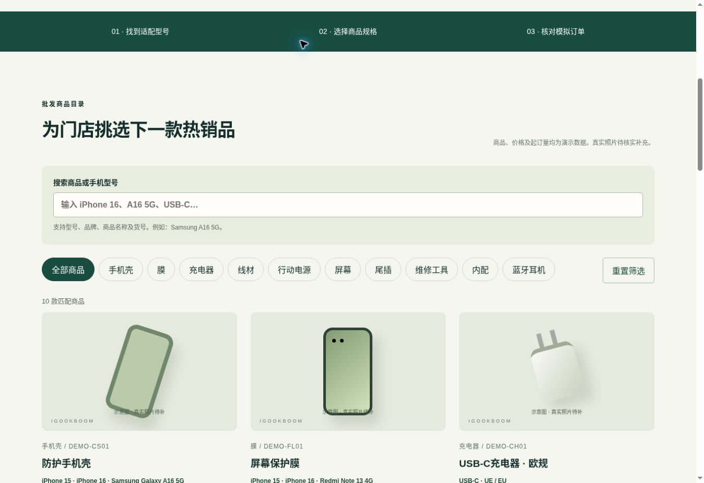
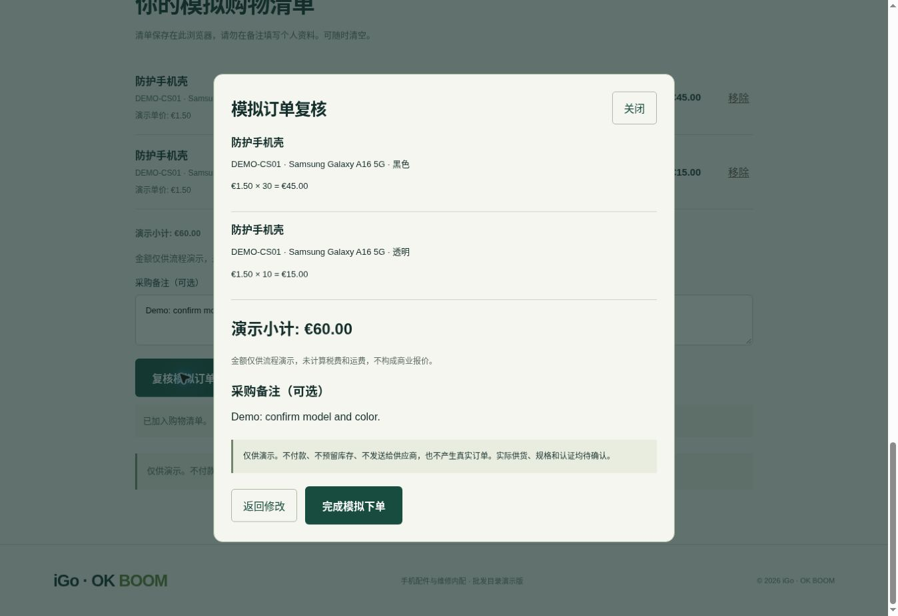

# v2 检查记录 · 2026-11-10

## 自动检查（已通过）

- `node --check app.js`、`catalog.js`、`i18n.js`。
- `node --test tests/catalog.test.cjs`：4项通过。覆盖10类完整性、唯一货号、金额与起订量数据、三语字段、HTML翻译键。

## Chrome 桌面实际操作（已通过）

1. 默认西班牙语，切换中文及英语后，分类、商品、提示和复核内容同步更新。
2. `a165g`、`三星A165G` 均匹配手机壳、屏幕和尾插3款演示商品；重置后恢复10款。
3. 手机壳选择 Samsung Galaxy A16 5G＋黑色＋10个，加入后演示小计€15.00。
4. 刷新页面后数量、规格、备注及语言恢复。
5. 实际键盘将数量改为30，小计更新为€45.00；输入0后退回30并显示校验提示。
6. 同型号透明款10个独立成为第二行，两行小计€60.00。
7. 详情示意图放大按钮可操作；复核显示货号、型号、颜色、数量、单价、小计和备注。
8. 模拟完成页面明确说明未发送订单、未扣款；TXT下载触发并返回完成文件。
9. 备注输入 `` 时，复核仅显示原文字，没有作为HTML执行。
10. 确认清空后数量为0、备注清空、结账及下载按钮禁用。

测试预览使用本地静态文件服务，不是网站发布。

## 待进一步验收

- 真正手机设备与移动端浏览器（本次未完成设备测试，响应式CSS已保留并扩展）。
- localStorage被禁用、损坏或容量耗尽时的实际浏览器场景（代码有异常保护和数据校验）。
- 实际产品照片加载、图片失败回退及真实报价（尚未提供已核实照片或报价）。
- 其他浏览器、跨标签页同步；本版未实现跨设备或跨标签实时同步。
- 本版没有后端服务、真实库存、税费、运输或订单对接。

## 检查截图

